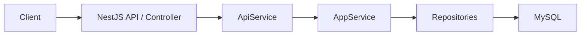
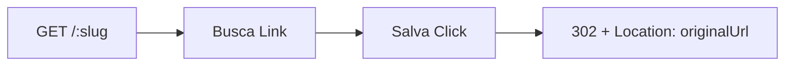

# URL Shortener API

API de encurtamento de URLs com contagem de acessos. O projeto transforma URLs longas em links curtos e mostra métricas básicas sem coletar dados de visitantes.

## O que faz

- Cria um Link a partir de uma URL HTTP(S) válida e devolve um slug de seis caracteres.
- Redireciona o slug com HTTP 302, registrando um Click antes da resposta.
- Informa o total de cliques e a data do último acesso por slug.
- Expõe health check e documentação interativa via Swagger.

## Stack e arquitetura

NestJS 11, TypeScript 5, TypeORM 0.3, MySQL 8.4, Node.js 22+, Jest/Supertest e Docker Compose.





O controller recebe e valida a requisição; ApiService encaminha o caso de uso; AppService coordena as regras; repositories acessam o MySQL. Se o Click não puder ser salvo, o redirect não é enviado.

## Endpoints

| Método | Rota                   | Resultado                                                           |
| ------ | ---------------------- | ------------------------------------------------------------------- |
| POST   | /links                 | Cria o link (201); URL inválida retorna 400                         |
| GET    | /:slug                 | Registra o clique e redireciona (302); slug inexistente retorna 404 |
| GET    | /links/:slug/analytics | Retorna métricas agregadas (200); slug inexistente retorna 404      |
| GET    | /health                | Retorna o estado básico da API (200)                                |

Swagger: http://localhost:3000/v1/docs/swagger (ajuste a porta se necessário).

Exemplo de criação:

```http
POST /links
Content-Type: application/json

{"url":"https://example.com/page"}
```

```json
{
  "id": "550e8400-e29b-41d4-a716-446655440000",
  "originalUrl": "https://example.com/page",
  "slug": "aB91xZ",
  "shortUrl": "http://localhost:3000/aB91xZ",
  "createdAt": "2026-09-24T18:00:00.000Z"
}
```

Os valores acima são ilustrativos: o slug e o UUID são gerados a cada criação. A base de shortUrl vem de APP_BASE_URL. O cliente não escolhe o slug.

```http
GET /aB91xZ

HTTP/1.1 302 Found
Location: https://example.com/page
```

Após esse acesso, GET /links/aB91xZ/analytics retorna, por exemplo:

```json
{
  "slug": "aB91xZ",
  "originalUrl": "https://example.com/page",
  "totalClicks": 1,
  "createdAt": "2026-09-24T18:00:00.000Z",
  "lastClickAt": "2026-09-24T18:30:00.000Z"
}
```

Sem acessos, totalClicks é 0 e lastClickAt é null. GET /health retorna {"message":"UP"}.

## Executar localmente

Requisitos: Docker com Compose e, para testes no host, Node.js 22+ e npm.

1. Copie o exemplo e substitua as duas senhas por valores locais; nunca versione o arquivo real:

   ```sh
   cp .env.example .env
   ```

   Configure PORT, APP_BASE_URL, DB_HOST, DB_PORT, DB_USER, DB_PASSWORD e DB_NAME. O Compose usa MYSQL_ROOT_PASSWORD para inicializar o MySQL e substitui DB_HOST por mysql dentro da rede. Para os E2E no host, mantenha DB_HOST=127.0.0.1, APP_BASE_URL local e DB_NAME terminado em _local.

2. Suba o banco, construa a API e execute a migration antes de iniciar a aplicação:

   ```sh
   docker compose up -d mysql
   docker compose build app
   docker compose run --rm app npm run migration:run:compiled
   docker compose up -d app
   ```

3. Abra http://localhost:3000/health e o Swagger na rota acima. O MySQL usa volume persistente; parar os containers com docker compose down não remove esse volume.

Se usar um MySQL externo ao Compose, exporte as variáveis DB_* antes de executar npm run migration:run: o CLI do TypeORM não carrega .env por conta própria. Para iniciar a API no host após configurar o banco, use npm ci e npm run start:dev.

## Testes

Com o MySQL e a API locais em execução:

```sh
npm ci
npm run build
npm run lint
npm test -- --runInBand
npm run test:e2e
```

Os testes unitários usam mocks e não dependem de MySQL. Os E2E usam a API e o MySQL reais, verificam criação, redirect, Click e analytics, e removem somente os Links que criam. O fluxo completo do MVP foi validado contra banco real.

## Estrutura

```text
src/api/                 Controller, ApiService e DTOs HTTP
src/common/app.service.ts Regras de aplicação
src/common/database/     Entidades, repositories, DataSource e migration
src/common/slug.service.ts Geração do slug
test/                    E2E com Jest e Supertest
robots/                  Diretrizes internas do projeto
```

## Decisões e limites

- IDs UUID; slug aleatório alfanumérico de seis caracteres, não derivado da URL.
- UNIQUE no slug, verificação prévia e até cinco tentativas; a violação de UNIQUE por concorrência também é tratada.
- Click tracking síncrono antes do 302. Click armazena apenas Link e data/hora.
- Analytics usa COUNT e MAX no banco, sem carregar todos os Clicks.
- Schema criado por migration; synchronize e migrationsRun permanecem false.
- MVP sem autenticação, dashboard, rate limiting ou métricas detalhadas por visitante. Antes de expor a API publicamente, são necessários controles de abuso e configuração de produção apropriados.

Evoluções possíveis: autenticação para gestão de links, proteção contra abuso, relatórios adicionais e automação de deploy/CI.
